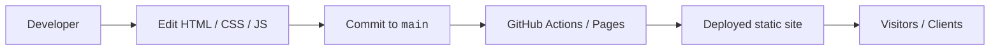

<h1 align="center">ilex-site</h1>

<!-- repo-badges:start -->
<p align="center">
  <a href="https://hits.sh/github.com/power0matin/ilex-site/"></a>
  <a href="https://github.com/power0matin/ilex-site/stargazers"></a>
  <a href="https://github.com/power0matin/ilex-site/forks"></a>
  <a href="https://github.com/power0matin/ilex-site/issues"></a>
  <a href="LICENSE"></a>
</p>
<!-- repo-badges:end -->

Landing page for **ilex**, a software engineering studio focused on scalable web systems, backend architectures, and developer tooling.

This repository contains the production source for the public marketing site of ilex.  
The repository is **private** and intended **only for ilex engineers and collaborators**.

> Live site: https://power0matin.github.io/ilex-site/


## Table of contents

- [Overview](#overview)
- [Features](#features)
- [Architecture](#architecture)
- [Tech stack](#tech-stack)
- [Environments](#environments)
- [Getting started](#getting-started)
- [Development workflow](#development-workflow)
- [Design system](#design-system)
- [Customization](#customization)
- [Security & privacy](#security--privacy)
- [Maintenance checklist](#maintenance-checklist)
- [Changelog](#changelog)
- [License](#license)

## Overview

`ilex-site` is a lightweight, static marketing site that:

- Presents ilex’s positioning as a backend-heavy engineering studio.
- Showcases services, preferred stack, and selected case studies.
- Provides a simple contact/intake form (currently client-side only).
- Mirrors the brand identity defined by the ilex logo, color system, and typography.

The goal is to keep this codebase:

- **Stable** — few moving parts, minimal dependencies.
- **Predictable** — simple deployment via GitHub Pages.
- **Easy to extend** — clear sections, reusable CSS utilities, and documented patterns.

## Features

- **Modern, technical visual identity**

  - Deep navy background & high-contrast typography
  - Geometric `i/x` monogram logo and brand-aligned palette
  - Flat, minimal aesthetic (no 3D, heavy gradients, or textures)

- **Complete marketing funnel**

  - Hero section with studio positioning and primary CTAs
  - Services overview (Backend, Web Applications, Developer Experience)
  - Preferred tech stack for quick technical qualification
  - Case studies with concise problem/solution/value narratives
  - Process section describing how ilex works with clients
  - About & metrics (experience, projects shipped, time zones)
  - Contact form and project-intake block

- **Polished UI/UX**
  - Sticky, glassmorphism-style navigation bar
  - Smooth in-page scrolling
  - Scroll-based reveal animations using `IntersectionObserver`
  - Card hover states and subtle depth/shadow use
  - Responsive layout from mobile to large desktop

## Architecture

The site is deliberately simple:

```text
.
├── index.html               # Single-page app shell
└── assets
    ├── css
    │   └── ilex-theme.css   # Brand tokens, layout, components, animations
    └── js
        └── main.js          # Navigation, scroll animations, form behavior
```

- **No build step** — everything is plain HTML/CSS/JS.
- **No runtime dependencies** — no npm, bundlers, or frameworks.
- **Animations** are CSS-based, triggered by `IntersectionObserver` in `main.js`.
- **Design system** is implemented via CSS custom properties (brand tokens).

<details>
<summary><strong>High-level flow</strong> (Mermaid diagram)</summary>



</details>

## Tech stack

This project is intentionally lightweight:

- **HTML5** – semantic sections and content structure.
- **CSS3** – custom design system, responsive grid, transitions, and animations.
- **Vanilla JavaScript** – navigation behavior, intersection observers, smooth scrolling, simple form handling.
- **GitHub Pages** – static hosting from the `main` branch.

No frameworks or external libraries are required or expected.

## Environments

| Environment | Host                                           | Branch | Notes                                  |
| ----------- | ---------------------------------------------- | ------ | -------------------------------------- |
| Local       | `http://localhost:8000` (or any static server) | n/a    | Used for development & visual review.  |
| Production  | `https://power0matin.github.io/ilex-site/`     | `main` | Public marketing site for all visitors |

> [!NOTE]
> Only the `main` branch is deployed to production via GitHub Pages.
> Any experimental work should happen on feature branches and only land on `main` via pull requests.

## Getting started

### 1. Access

This repository is **private**. Only members of the ilex organization/team with explicit access should clone or fork it.

### 2. Clone

Use SSH if you have keys configured:

```bash
git clone git@github.com:power0matin/ilex-site.git
cd ilex-site
```

Or HTTPS (requires GitHub authentication):

```bash
git clone https://github.com/power0matin/ilex-site.git
cd ilex-site
```

### 3. Run locally

You can open `index.html` directly in a browser, or use a lightweight static server.

Using Python:

```bash
# Python 3.x
python -m http.server 8000
# → open http://localhost:8000 in your browser
```

Any other static server (e.g. `live-server`, `serve`, nginx) is also fine.

## Development workflow

This repository is small, but we still follow consistent engineering practices.

### Branching model

- `main` — always deployable; reflects what’s currently live or ready to be deployed.
- Feature branches — short-lived branches per task:

```bash
git checkout -b feat/update-hero-copy
# ...
git push -u origin feat/update-hero-copy
```

Merge to `main` via pull requests (even for small changes) to keep history and review.

### Commit conventions

We follow a lightweight version of **Conventional Commits**:

Examples:

```text
feat(site): add ilex landing page
fix(hero): correct scroll anchor offset
chore(css): tidy spacing utilities
docs(readme): update internal guidelines
```

Types you can use: `feat`, `fix`, `chore`, `refactor`, `docs`, `style`, `test`.

### Code review expectations

- Keep PRs small and focused.
- Include before/after screenshots/GIFs for visual changes.
- Mention any design tokens or components you changed (`@ilex-design` in PR description if relevant).
- Ensure the site still works on at least:

  - latest Chrome
  - latest Firefox
  - one mobile viewport (DevTools responsive mode is fine).

## Design system

Brand tokens live in `assets/css/ilex-theme.css` under `:root`:

```css
:root {
  --ilex-bg: #020617; /* Main background (deep navy) */
  --ilex-bg-elevated: #050b1a; /* Elevated surfaces / cards */
  --ilex-primary: #2f86ff; /* Primary blue (logo & CTAs) */
  --ilex-primary-soft: #1d5fe0; /* Hover/active blue */
  --ilex-accent: #d9ff4f; /* Lime accent (logo dot / highlights) */

  --ilex-text: #e5e7eb; /* Primary text */
  --ilex-text-muted: #9ca3af; /* Secondary text */

  --ilex-border: #1f2937; /* Subtle borders */
}
```

> [!TIP]
> When changing the visual identity, update these tokens first.
> Layout and components reference them, so most of the site will adapt automatically.

Patterns:

- **Layout**: `.ilex-section`, `.ilex-container`, `.ilex-grid-*`
- **Cards**: `.ilex-card` with optional modifiers (`.ilex-service-card`, `.ilex-case-card`, etc.)
- **Buttons**: `.ilex-btn`, `.ilex-btn-primary`, `.ilex-btn-outline`
- **Typography**: `.ilex-card-title`, `.ilex-card-subtitle`, `.ilex-section-header`

Animations are applied via `[data-animate]` attributes and the `.is-visible` class, toggled in `main.js`.

## Customization

Typical extension points for ilex devs:

- **Content**

  - Edit copy in `index.html` (services, stack, case studies, contact details).
  - Keep headings short and precise; avoid marketing buzzwords.

- **Sections**

  - Reuse the `.ilex-section` pattern for new blocks (blog, hiring, FAQ).
  - For new cards, start from `.ilex-card` and add minimal modifiers.

- **Brand & visuals**

  - Swap inline SVG logos in header/footer if the brand mark evolves.
  - Update CSS tokens instead of hardcoding new colors.

- **Integrations**

  - Wire the contact form to:

    - a backend endpoint,
    - a serverless function,
    - or an external intake service.

  - When doing so, document endpoints and any environment variables in a separate internal doc (not in this README).

## Security & privacy

> [!IMPORTANT]
> This repository is still part of the public-facing surface of ilex.

- Do **not** commit secrets, API keys, access tokens, or internal URLs.
- Do **not** expose internal tools, admin endpoints, or internal architecture diagrams here.
- All dynamic integrations (e.g. form handling) must respect:

  - minimal data collection,
  - no sensitive data logging,
  - GDPR/privacy best practices where relevant.

For anything involving user data or authentication, coordinate with the backend team before shipping.

## Maintenance checklist

Internal checklist for ilex engineers when touching this repository:

- [ ] Local build works and pages render correctly.
- [ ] No console errors or obvious layout issues on latest Chrome/Firefox.
- [ ] Mobile layout verified at ~375px width.
- [ ] Accessibility basics checked (landmarks, contrast, focus states).
- [ ] All internal links (anchors) scroll to correct sections.
- [ ] README and any relevant docs updated if behavior or structure changed.
- [ ] PR reviewed by at least one other engineer before merging to `main`.

## Changelog

We recommend tracking meaningful changes either via:

- GitHub **Releases**, or
- a `CHANGELOG.md` file following [Keep a Changelog](https://keepachangelog.com/) style.

For now, Git history (and PR titles) acts as the canonical changelog.

## License

This project is licensed under the **MIT License**.
See [`LICENSE`](./LICENSE) for details.

Although the code is MIT-licensed, this repository remains **private** and intended for internal use within the ilex engineering team.

## Contact

**Matin Shahabadi**

- Website: [matinshahabadi.ir](https://matinshahabadi.ir)
- Email: [me@matinshahabadi.ir](mailto:me@matinshahabadi.ir)
- GitHub: [power0matin](https://github.com/power0matin)
- LinkedIn: [matin-shahabadi](https://www.linkedin.com/in/matin-shahabadi)

<p align="center">
  <b>If this helped you, consider giving it a star!</b><br>
  <sub>Your support keeps the project alive and helps others find it.</sub>
</p>

<!-- Copy-paste in your Readme.md file -->
<p align="center">
  <a href="https://next.ossinsight.io/widgets/official/analyze-repo-stars-history?repo_id=1100834947" target="_blank" style="display: block" align="center">
    <picture>
      <source media="(prefers-color-scheme: dark)" srcset="https://next.ossinsight.io/widgets/official/analyze-repo-stars-history/thumbnail.png?repo_id=1100834947&amp;image_size=auto&amp;color_scheme=dark" width="721" height="auto">
      
    </picture>
  </a>
</p>

<!-- Made with [OSS Insight](https://ossinsight.io/) -->

<p align="center">
  Created by <a href="https://github.com/power0matin">power0matin</a>
</p>
